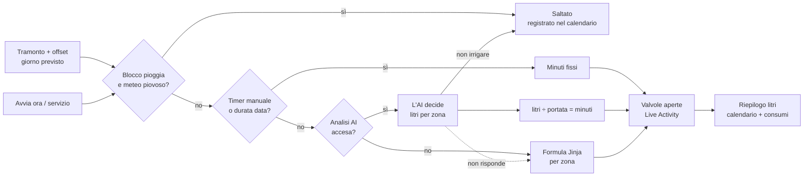

<p align="center">
  
</p>

<h1 align="center">💧 Irrigazione AI</h1>

<p align="center">
  <b>L'impianto di irrigazione che decide da solo quanta acqua dare, zona per zona.</b><br>
  Un wizard, nessuna automazione da scrivere. Formula tua o agronomo AI, Live Activity sul telefono, registro dei litri.
</p>

<p align="center">
  <a href="https://github.com/acaonweb/irrigazione-ai/actions/workflows/validate.yml"></a>
  
  
  
  
</p>

---

Di solito un impianto di irrigazione in Home Assistant è un groviglio di helper, sensori template e automazioni che solo chi le ha scritte capisce. **Irrigazione AI** lo sostituisce con un'unica integrazione. Le valvole, i sensori di umidità e il meteo li scegli da un wizard. Lei decide quando partire e quanto irrigare ogni zona, ti avvisa sul telefono e tiene il conto dell'acqua.

## ✨ Cosa sa fare

### 🧭 Un wizard al posto delle automazioni
Impianto, zone, programmazione, formula, AI e notifiche si configurano in pochi passi guidati, con descrizioni chiare per ogni campo. Le zone si aggiungono e si modificano quando vuoi dalla pagina dell'integrazione. Nessun file YAML, nessun riavvio.

### 🌱 Ogni zona è diversa
Una zona è una valvola (`switch` o `valve`) con i suoi dati:
- sensore di umidità del terriccio;
- portata in L/min;
- durata minima e massima;
- coefficiente;
- volume del terriccio;
- esposizione.

Le zone partono in parallelo o una dopo l'altra, utile se la pressione dell'acqua è bassa.

### 🧪 La formula la scrivi tu
La durata si calcola con un **template Jinja** nello stesso editor di Home Assistant. Hai a disposizione umidità, temperatura, meteo, portata, volume, esposizione e qualsiasi `states('sensor.xxx')`. Prima di salvare vedi **in anteprima quanti minuti darebbe a ogni zona** con i valori di adesso. Vuoi solo un timer fisso? `{{ 20 }}` e hai finito.

### 🤖 Un agronomo AI, senza server esterni
Accendi *Analisi AI* e prima di ogni ciclo un modello decide **se irrigare e quanti litri dare a ogni zona**. Tiene conto di:
- evapotraspirazione;
- pioggia caduta nelle ultime 12 ore (dallo storico di Home Assistant);
- previsioni orarie;
- esposizione e volume del terriccio.

Funziona con un'**entità AI Task** già configurata in Home Assistant oppure con la **tua API key** (OpenAI, Anthropic Claude, Google Gemini), o con **Ollama in locale**. Prima di salvare la chiave viene verificata con una richiesta di prova. Il pulsante *Analizza ora* ti fa vedere cosa farebbe l'AI senza aprire una valvola.

### 📱 Live Activity su iPhone e Android
Durante l'irrigazione il telefono mostra una **Live Activity** (schermata di blocco e Dynamic Island su iPhone) o un **Live Update** (Android 16+):

```
💧 Irrigazione in corso · AI                                   17:41
1️⃣ Secondo piano · fine 17:41
2️⃣ Sottotetto · fine 17:30
```

Gli aggiornamenti sono silenziosi, il suono arriva solo all'avvio e alla fine. Alla fine compare il riepilogo dei litri (`☑️ Secondo piano · 30 min · 21,8 L`) e dopo 5 minuti l'attività sparisce da sola. Funziona anche per le valvole aperte a mano, con l'ora della chiusura di sicurezza. Un tocco apre la dashboard che scegli.

### 📒 Registro e consumi d'acqua
Un **calendario** registra:
- ogni ciclo, con minuti e litri reali per zona e da dove è partito;
- le aperture manuali;
- i cicli saltati, con il motivo (pioggia, decisione dell'AI);
- la **prossima irrigazione prevista**.

I sensori *Acqua oggi / questo mese / totale*, per l'impianto e per ogni zona, si possono aggiungere alla **dashboard Energia**.

### 🛡️ Pensato per non allagare niente
- **Blocco pioggia** collegato al meteo.
- **Chiusura di sicurezza** per le valvole aperte a mano.
- **Chiusura automatica** delle valvole rimaste aperte se Home Assistant si riavvia a metà ciclo.
- **Tre tentativi** di chiusura per ogni valvola, con avviso se non si chiude.
- Se l'AI non risponde scegli tu se irrigare con la formula, spegnere l'AI o saltare il ciclo. In ogni caso ricevi una notifica.

### 🎛️ Una card pronta all'uso
La card `custom:irrigazione-ai-card` si registra da sola. Mostra:
- stato e avvio/stop;
- prossima irrigazione o tempo rimanente;
- litri di oggi e del mese;
- la decisione dell'AI;
- per ogni zona: umidità, minuti previsti e AI, litri e ora di fine (con le gocce che cadono mentre irriga).

Dalla card si cambiano anche frequenza, timer, blocco pioggia e AI.

## 🔄 Come nasce un ciclo



## 📦 Installazione

1. In Home Assistant apri **Impostazioni → Marketplace** (prima della 2026.11: **HACS**).
2. **Aggiungi da link** → `https://github.com/acaonweb/irrigazione-ai`, categoria *Integrazione*.
3. Installa **Irrigazione AI** e riavvia Home Assistant.
4. **Impostazioni → Dispositivi e servizi → Aggiungi integrazione → Irrigazione AI.**

## 🧭 Il wizard, passo per passo

| Passo | Cosa chiede |
| --- | --- |
| 1. Impianto | Nome; entità meteo e sensori di temperatura e umidità esterna, tutti facoltativi (senza meteo il blocco pioggia resta inattivo) |
| 2. Zone | Una o più zone: valvola, sensore del terriccio, portata, durata minima e massima, coefficiente, volume, esposizione, formula propria facoltativa |
| 3. Programmazione | Minuti dopo il tramonto, giorni per le frequenze, zone in parallelo o in sequenza, chiusura di sicurezza, chiusura al riavvio, dispositivi per la Live Activity, pagina da aprire, altre notifiche (per esempio Pushover) |
| 4. Formula | Editor Jinja con anteprima dei minuti per zona |
| 5. Analisi AI | Nessuna, AI Task, OpenAI, Anthropic, Gemini od Ollama; comportamento se l'AI non risponde; note per l'AI (piante, vasi, clima) |

Tutto si può cambiare dopo da **Configura** (opzioni) e da **Aggiungi zona / Riconfigura** sulle singole zone.

## 🎛️ Card

```yaml
type: custom:irrigazione-ai-card
entity: sensor.irrigazione_stato   # facoltativo: il sensore "Stato" dell'impianto
title: Terrazzo                    # facoltativo
```

Toccando una zona apri o chiudi la sua valvola (vale la chiusura di sicurezza).

## 🧩 Entità

| Entità | A cosa serve |
| --- | --- |
| Interruttore *Irrigazione* | Acceso = ciclo in corso. Accenderlo avvia, spegnerlo ferma e chiude le valvole |
| Interruttore *Blocco pioggia* | Se il meteo indica pioggia il ciclo non parte |
| Interruttore *Analisi AI* | A ogni ciclo l'AI decide se e quanto irrigare |
| Selettore *Frequenza* | Spenta, una o due volte a settimana, tutti i giorni |
| Selettore *Timer manuale* | 15/30/60 minuti per tutte le zone al posto della formula |
| Pulsanti *Avvia ora*, *Ferma*, *Analizza ora* | Comandi immediati |
| Sensori *Stato*, *Tempo rimanente*, *Prossima irrigazione*, *Ultima irrigazione*, *Ultimo blocco* | Stato dell'impianto |
| Sensore *Decisione AI* | Irrigare / Saltare / Errore, con motivo e litri per zona |
| Sensori *Acqua oggi*, *Acqua questo mese*, *Acqua totale* | Litri di tutte le zone |
| Calendario *Registro irrigazioni* | Cicli, aperture manuali, cicli saltati, prossima irrigazione |
| Per zona: *Durata prevista*, *Durata AI*, *Fine prevista*, *Acqua oggi*, *Acqua totale* | Minuti, litri e orari della zona; nella durata prevista ci sono anche formula usata ed eventuale errore |

## 🛠️ Servizi

| Servizio | Cosa fa |
| --- | --- |
| `irrigazione_ai.start` | Avvia un ciclo. Facoltativi: `config_entry_id`, `duration` (minuti per tutte le zone), `force` (ignora il blocco pioggia) |
| `irrigazione_ai.stop` | Ferma il ciclo e chiude le valvole |
| `irrigazione_ai.analyze` | Chiede all'AI una valutazione senza irrigare e restituisce decisione, motivo, litri e minuti per zona |

## 🧪 La formula nel dettaglio

Formula predefinita:

```jinja
{{ (20 + 20 * (100 - moisture) / moisture + 20 * temperature / 25) * 0.9 * weather_factor * coefficient }}
```

| Variabile | Significato |
| --- | --- |
| `moisture` | Umidità del terriccio della zona in % (minimo 10; 50 senza sensore) |
| `moisture_raw` | Umidità del terriccio così com'è (`none` se manca) |
| `temperature` | Temperatura esterna in °C (20 se manca) |
| `humidity` | Umidità esterna in % (`none` se manca) |
| `weather` | Stato dell'entità meteo (`sunny`, `cloudy`, `rainy`…) |
| `weather_factor` | Sereno 1,1 · poco nuvoloso 0,8 · nuvoloso 0,5 · nebbia 0,6 · pioggia 0,2 · altro 1 |
| `coefficient`, `flow_rate`, `soil_volume`, `exposure` | Dati della zona (portata in L/min, volume in L, `north`/`south`/`east`/`west`) |
| `min_duration`, `max_duration` | Limiti della zona in minuti |

Il risultato resta sempre tra durata minima e massima. Se una formula personalizzata smette di funzionare, per esempio perché un sensore diventa non disponibile, si usa quella predefinita e l'errore compare nell'attributo `formula_error`.

```jinja
{# Litri in base al volume del terriccio, convertiti in minuti #}
{{ soil_volume * (60 - moisture) / 100 / flow_rate }}

{# Più acqua con l'esposizione a sud #}
{{ (40 - moisture / 2) * (1.3 if exposure == 'south' else 1) * weather_factor }}

{# Tempo fisso deciso da un helper #}
{{ states('input_number.minuti_irrigazione') | float(20) }}
```

## 🤖 L'AI nel dettaglio

**Cosa riceve:**
- data e ora;
- posizione approssimata (un solo decimale);
- meteo attuale;
- ore e percentuale di pioggia nelle ultime 12 ore;
- previsioni orarie delle prossime 12 ore;
- per ogni zona: umidità del terriccio, volume, esposizione, portata, limiti e minuti della formula;
- le tue note.

**Le regole che segue:**
- stima l'evapotraspirazione;
- sottrae la pioggia caduta e quella prevista;
- non irriga se ha piovuto per più di metà delle ore recenti o se è attesa pioggia significativa;
- dà 0 litri sopra il 70% di umidità del terriccio;
- dà un minimo di mantenimento tra 50% e 65%;
- con l'esposizione a sud aumenta l'acqua, a nord la riduce.

**Cosa restituisce:** se irrigare, un motivo breve (nella lingua di Home Assistant) e litri e motivo per ogni zona. I litri diventano minuti con la portata della zona, arrotondati per eccesso e limitati tra minimo e massimo. Una zona con 0 litri resta chiusa.

**Se qualcosa va storto:**
- *irriga con la formula* (predefinito);
- *irriga con la formula e spegni l'analisi AI*;
- *salta il ciclo*.

In ogni caso arriva una notifica. Con il timer manuale, o con una durata passata a `irrigazione_ai.start`, l'AI non viene interpellata.

## 📒 Storico e consumi

I litri si calcolano come tempo di apertura per portata, per ogni apertura (cicli e manuali), e si aggiornano ogni 30 secondi mentre una valvola è aperta. "Oggi" si azzera a mezzanotte, "questo mese" il primo del mese. Storico e contatori restano dopo i riavvii (sono salvati in `.storage`) e vengono cancellati se rimuovi l'integrazione. Il registro conserva gli ultimi 1000 eventi.

## ❓ Domande frequenti

**Posso usarla senza sensori?** Sì. Meteo e sensori sono tutti facoltativi. Con la formula `{{ 20 }}` hai un timer fisso con programmazione, sicurezza e registro.

**Quanto costa l'AI?** Una richiesta per ciclo, più quelle che lanci con *Analizza ora*: con modelli piccoli (per esempio `gpt-4.1-mini` o `gemini-2.5-flash`) sono frazioni di centesimo. Con Ollama in locale è gratis.

**La Live Activity funziona su Android?** Sì, come Live Update da Android 16. Sulle versioni precedenti arriva come notifica normale, che si aggiorna al suo posto.

**Posso avere più impianti?** Sì: aggiungi l'integrazione più volte, una per impianto (per esempio terrazzo e giardino).

---

## English

**Irrigazione AI** turns a messy pile of helpers and automations into one Home Assistant integration, set up through a wizard:
- per-zone durations from a **Jinja formula you write**, with a live preview;
- an optional **AI agronomist** (Home Assistant AI Task, OpenAI, Anthropic, Gemini or local Ollama) that decides liters per zone from rain history, forecast and soil data;
- **Live Activities on iPhone and Live Updates on Android 16+**;
- a **calendar log** with real liters per zone;
- **water sensors** for the Energy dashboard;
- **safety closing** of valves;
- a ready-made **Lovelace card**.

Install from the Marketplace (or HACS) with **Add from link**, then add the *Irrigazione AI* integration. UI in Italian and English.

## Licenza

MIT
