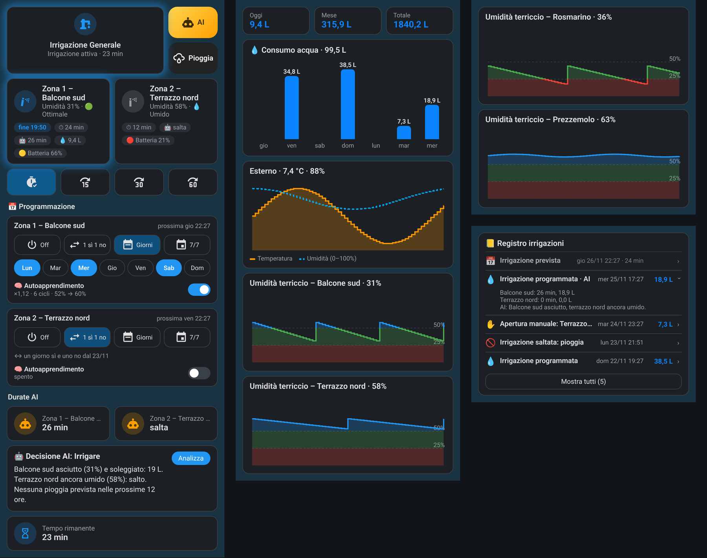
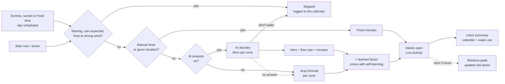

<p align="center">
  <a href="README.it.md">🇮🇹 Italiano</a> · <b>🇬🇧 English</b>
</p>

<p align="center">
  
</p>

<h1 align="center">
  <picture>
    <source media="(prefers-color-scheme: dark)" srcset="custom_components/irrigazione_ai/brand/dark_logo@2x.png">
    
  </picture>
</h1>

<p align="center">
  <b>The irrigation system that decides on its own how much water to give, zone by zone.</b><br>
  One wizard, no automations to write. Your own formula or an AI agronomist, Live Activities on your phone, a log of the liters used.
</p>

<p align="center">
  <a href="https://github.com/acaonweb/irrigazione-ai/actions/workflows/validate.yml"></a>
  
  
  
  
  <a href="https://buymeacoffee.com/acaonweb"></a>
</p>

---

An irrigation system in Home Assistant is usually a tangle of helpers, template sensors and automations that only the person who wrote them understands. **Irrigazione AI** replaces it with a single integration. You pick the valves, the moisture sensors and the weather in a wizard. It decides when to start and how much to water each zone, notifies you on your phone and keeps track of the water used.

> The name is Italian ("irrigazione" means irrigation). The whole integration — forms, entities, cards, notifications, Live Activities and calendar — is available in English and Italian.

## ✨ What it does

### 🧭 A wizard instead of automations
System, zones, scheduling, formula, AI and notifications are set up in a few guided steps, with a clear description for every field. Zones can be added and edited at any time from the integration page. No YAML files, no restarts.

### 🌱 Every zone is different
A zone is a valve (`switch` or `valve`) with its own data:
- soil moisture sensor;
- flow rate in L/min;
- minimum and maximum duration;
- coefficient;
- soil volume;
- exposure;
- the **plants** growing there, in your own words (for example "rosemary and lavender" or "tomatoes").

Zones run in parallel or one after another, useful when water pressure is low.

### 📅 Every zone has its own days
For each zone you choose when to water, also straight from the card:
- **off**;
- **every other day**, starting from the day you choose it;
- **chosen days**, as many as you like (for example Monday, Wednesday, Saturday and Sunday);
- **every day**.

At the scheduled time only the zones due that day start. *Start now* waters every zone except those that are off. Changing the days does not reload the integration and does not interrupt a running cycle.

### 🧪 You write the formula
The duration is computed by a **Jinja template** in the same editor Home Assistant uses. You have moisture, temperature, weather, flow rate, volume, exposure and any `states('sensor.xxx')` at hand. Before saving you see a **preview of how many minutes each zone would get** with the current values. Just want a fixed timer? `{{ 20 }}` and you're done.

### 🤖 An AI agronomist, no external servers
Turn on *AI analysis* and before every cycle a model decides **whether to water and how many liters to give each zone**. It takes into account:
- evapotranspiration;
- rain over the last 12 hours (from Home Assistant's history);
- hourly forecast;
- exposure and soil volume;
- the **plants** of each zone: rosemary, lavender and succulents want little water, vegetables and young plants more.

It works with an **AI Task entity** already set up in Home Assistant, with **your own API key** (OpenAI, Anthropic Claude, Google Gemini), or with **local Ollama**. Before saving, the key is checked with a test request. The *Analyze now* button shows what the AI would do without opening a valve.

And the **prompt is yours**: you edit it in the options as a Jinja template, with all the data available. The integration always appends the response format, so no edit can break the liters calculation.

### 🌵 Dry soil alarm
If a zone's soil moisture stays **below the threshold for 5 minutes** (25% by default, changeable in the options; 0 = off) you get a notification on the *Other notifications* services, for example Pushover. Only one per episode: the zone goes back to "normal" once it rises at least 3 points above the threshold. Every zone with a sensor has a *Dry soil* binary sensor, handy for dashboards or your own automations, and the card turns the zone red at the same threshold.

### 🧠 Every zone learns its own dose
Turn on **self-learning** for a zone (in the zone form or straight from the card) and it corrects its own dose. After each watering it watches how far the soil moisture rises over the next 3 hours. If the peak stays below the target (60% by default), the zone gets a bit more water next time; if it goes above, a bit less. The correction is a factor that multiplies the formula or AI minutes, up to 15% per cycle and between ×0.5 and ×2, always within the zone's minimum and maximum. It needs a soil moisture sensor; a sample is discarded if it rains in the meantime, and fixed-duration cycles don't count. You choose zone by zone: on the balcony yes, in the attic no.

### ☔ Rain on the way, frost and wind
Besides rain falling now, a cycle is skipped when:
- **rain is expected** within the next hours (2 by default), from the weather entity's hourly forecast;
- it's **frosty**: temperature below 3 °C now or in the next 3 hours;
- the **wind is strong**: above 30 km/h, from your wind sensor or the weather entity.

Every threshold can be changed or turned off, and **every check only uses the data that's there**: if your weather service has no hourly forecast or no wind, that check is skipped and watering goes ahead. A missing data point never blocks the system.

### 📱 Live Activities on iPhone and Android
While watering, your phone shows a **Live Activity** (lock screen and Dynamic Island on iPhone) or a **Live Update** (Android 16+):

```
💧 Watering · AI                                               17:41
1️⃣ Second floor · ends 17:41
2️⃣ Attic · ends 17:30
```

> You need the **Home Assistant (Companion) app** on your phone and **working remote access** to Home Assistant (Home Assistant Cloud / Nabu Casa or your own external URL). Details in the [guide, step 5](#5-live-activities-requirements-and-setup).

Updates are silent; sound plays only at start and end. At the end a liters summary appears (`☑️ Second floor · 30 min · 21.8 L`) and after 5 minutes the activity goes away by itself. It also works for valves opened by hand, showing the safety-close time. A tap opens the dashboard of your choice.

### 📒 Log and water use
A **calendar** records:
- every cycle, with real minutes and liters per zone and what started it;
- manual openings;
- skipped cycles, with the reason (rain, AI decision);
- the **next planned watering**.

The *Water today / this month / total* sensors, for the system and for each zone, can be added to the **Energy dashboard**.

### 🛡️ Built not to flood anything
- **Rain block** tied to the weather or, better, to **your own rain sensor**, plus **rain expected**, **frost** and **strong wind**.
- **Safety close** for valves opened by hand.
- **Automatic closing** of valves left open if Home Assistant restarts mid-cycle.
- **Three closing attempts** per valve, with an alert if it won't close.
- If the AI doesn't answer, you choose whether to water with the formula, turn the AI off or skip the cycle. Either way you get a notification.

### 🎛️ Four ready-to-use cards
They register themselves on install and need no mushroom, button-card or apexcharts.

- **`custom:irrigazione-ai-card`, the controls:**
  - the main tile with the status (running, idle with the next watering, skipped for rain, rain expected, frost, wind or by the AI);
  - the yellow *AI* and *Rain* buttons;
  - one tile per zone, with moisture (🔴 dry, 🟢 optimal, 💧 wet), planned and AI minutes, liters, end time and valve battery. It lights up blue with a swinging sprinkler while watering, and red when the soil is dry;
  - the timer row (off/15/30/60);
  - the **schedule of each zone**: Off, every other day, Days, 7/7 and the weekdays to tap, with the next watering, plus the **self-learning** switch with the learned factor;
  - planned or AI durations, the AI decision with the *Analyze* button and the time remaining.
- **`custom:irrigazione-ai-log-card`, the irrigation log:** compact, one row per event (cycles, manual openings, skipped cycles with the reason) with day, time and liters, plus the next planned watering. Tap a row to see each zone's minutes and liters; "Show all" expands the list.
- **`custom:irrigazione-ai-moisture-card`, soil moisture of sensors of your choice:** the same chart with red, green and blue bands, for plants that aren't zones of the system (hand-watered pots, herbs…).
- **`custom:irrigazione-ai-charts-card`, the charts:** liters today, this month and in total; water use of the last 7 days as bars; outdoor weather of the last 24 hours; soil moisture of each zone over the last 5 days, with red, green and blue bands.

## 🔄 How a cycle comes about



## 📦 Installation

[](https://my.home-assistant.io/redirect/hacs_repository/?owner=acaonweb&repository=irrigazione-ai&category=integration)

The button opens the Irrigazione AI page right in your Home Assistant. Otherwise:

1. In Home Assistant open **Settings → Marketplace** (before 2026.11: **HACS**) and search for **Irrigazione AI**.
2. Install **Irrigazione AI** and restart Home Assistant.
3. **Settings → Devices & services → Add integration → Irrigazione AI.**
4. Follow the wizard (the field-by-field guide is below), then add the cards to a dashboard.

## 📖 Practical guide

This section calmly explains everything the wizard asks you. If it's your first time, read it once from start to finish: it saves you the most common surprises.

### 1. What you need before you start

| What | Required? | How to find it |
| --- | --- | --- |
| One **valve** per zone, seen by Home Assistant as a `switch.…` or `valve.…` entity | Yes | *Settings → Devices & services → Entities*, search for the valve's name. Turning it on and off must open and close the water |
| One **soil moisture sensor** per zone (`sensor.…` in %) | No | Without a sensor the formula assumes 50%, the AI gets "unknown" and there is no dry soil alarm |
| A **weather entity** (`weather.…`), for example the Met.no one Home Assistant installs by itself | No, but recommended | Used by the rain block, the formula (`weather_factor`) and the AI (forecast) |
| **Outdoor temperature and humidity** sensors | No | If missing, those of the weather entity are used |
| Your own **rain sensor** (rain gauge, rain detector, weather station) | No | More reliable than the weather for the rain block: see step 3b |
| A **wind sensor** (`sensor.…` in km/h, m/s, mph or knots) | No | Only if your weather entity has no wind, or you have a weather station: see step 3b |
| The **Home Assistant (Companion) app** on your phone | Only for Live Activities and phone notifications | App Store or Google Play, signed in to your Home Assistant |
| **Remote access** to Home Assistant | Only for Live Activities | Home Assistant Cloud (Nabu Casa) or your own external HTTPS URL, also entered in the app |

### 2. A zone's data, explained

**Flow rate (L/min).** How much water comes out of the zone in one minute. It turns minutes into liters and back. Two ways to get it:
- *from the drippers*: number of drippers × liters/hour of each ÷ 60. For example 22 drippers at 2 L/h give 22 × 2 ÷ 60 = **0.73 L/min**;
- *by measuring*: put a dripper (or the end of the line) in a measuring jug for 5 minutes, divide the liters by 5 and, if you measured a single dripper, multiply by the number of drippers.

**Minimum and maximum duration.** Any result (formula or AI) is kept within these limits. The minimum avoids pointless 1-minute runs, the maximum protects you from a wrong value. The exception is the AI deciding 0 liters for a zone: then the zone stays closed.

**Coefficient.** A multiplier for the default formula: 1 = unchanged, 1.2 = 20% more water, 0.8 = 20% less. Handy for a zone that dries out before the others.

**Soil volume (L).** How much soil there is to wet. The AI uses it to size the liters: more soil, more water to reach the same moisture. To estimate it:
- rectangular planter: length × width × soil depth, in cm, ÷ 1000. For example 100 × 20 × 18 cm = **36 L**;
- round pot: 3.14 × radius × radius × depth, in cm, ÷ 1000;
- several pots on the same line: add up the volumes.

**Exposure.** Which side the zone gets the sun from (north, south, east, west). South and west dry out more, north less. The AI uses it; in the formula it is available as the `exposure` variable.

**Plants.** Write in your own words what grows in the zone, as precisely as you can: "rosemary, lavender and thyme in a planter", "tomatoes and basil", "lemon tree in a 50 cm pot", "freshly transplanted geraniums". The AI knows the water needs of common plants and doses accordingly: Mediterranean plants want little, vegetables, flowers and young plants more. You can also use them in the formula with the `plants` variable.

**Zone formula.** Optional: if you write one, it applies only to this zone and replaces the system's formula (see step 6).

### 3. When to water: time and days

**The time** applies to the whole system and is chosen in *Scheduling*:
- **sunset** or **sunrise**, plus an offset in minutes. Positive = after, negative = before: `-30` with sunrise means half an hour before the sun comes up;
- **fixed time**, for example 21:00. The offset doesn't count in this case.

Watering in the evening or at dawn reduces evaporation: it's the best choice in summer.

**The days** are chosen per zone, in the zone form or from the card (📅 Schedule section):

| Choice | What happens | Example |
| --- | --- | --- |
| Off | The zone never waters, not even with *Start now* | In winter, or a temporarily empty zone |
| Every other day | Waters on the day you choose it, then every other day, regardless of the week | Chosen on Tuesday: Tue, Thu, Sat, Mon, Wed… |
| Chosen days | Waters on the weekdays you pick | Mon, Wed, Sat and Sun |
| Every day | Every day | High summer, small pots |

In the form, the *Days* field counts **only** with "Chosen days" and is ignored otherwise. On the card just tap the days: the row lights up blue and the change applies right away.

At the scheduled time only the zones due that day start. *Start now* (or the *Irrigation* switch) instead starts every zone that isn't off.

### 3b. Rain: weather or your own sensor

The **rain block** (the *Rain block* switch, the yellow *Rain* button on the card) prevents a start while it's raining. To know that, the integration uses:

1. the **rain sensor**, if you set one in the first wizard step (or in *Configure*);
2. otherwise the **weather entity**, which however is a forecast for your area and doesn't know whether it's raining right on your balcony.

The rain sensor can be:

| Type | Examples | When it means "raining" |
| --- | --- | --- |
| Binary sensor | Zigbee rain sensor, wetness contact, a weather station's `binary_sensor.rain` | When it's **on** |
| Numeric sensor | Rain rate (mm/h) or rainfall (mm) from Ecowitt, Netatmo, a rain gauge | When the value is **greater than 0** |
| Text sensor | State "rain"/"raining"/"wet" (Italian "pioggia", "bagnato" too) | When the text means rain |

For the block a **rate** sensor (mm/h) or a binary sensor works best: a *today's rainfall* counter stays above 0 until midnight and would also block evening watering after a morning shower. If that's exactly what you want, fine.

If the sensor stops responding (unavailable), the integration falls back to the weather: you're never left without a block. The sensor is also used by the **AI** (whether it's raining now and how many of the last 12 hours had rain) and in the **formula**, through the `raining` variable (true or false).

**Rain expected, frost and wind.** In the options (*Scheduling*) there are three more checks, made when a cycle is about to start:

| Check | Default | Data used | Turn off |
| --- | --- | --- | --- |
| **Rain expected within** | 2 hours | Hourly forecast of the weather entity: an hour counts as rainy with a rainy condition, at least 0.5 mm or a probability of 70% or more | 0 hours (or turn off the rain block) |
| **Frost: don't water below** | 3 °C | Outdoor temperature (sensor or weather) and the next 3 hours of forecast | Empty field |
| **Strong wind: don't water above** | 30 km/h | Wind sensor, or the weather entity's wind if the sensor is missing or not responding | 0 km/h |

The rain expected check follows the *Rain block* switch, like the rain falling now; frost and wind are always active as long as they have a threshold. If a datum is missing (no hourly forecast, no wind, no temperature) that check is **skipped** and watering goes ahead. Every skipped cycle is in the calendar with the reason, and you get a notification. `irrigazione_ai.start` with `force: true` ignores all these blocks.

### 3c. Time and date format

In the options (*Scheduling*) choose:
- **Time format**: automatic, 24 hours (15:30) or 12 hours (3:30 PM). Applies to the cards and the Live Activity;
- **Date format**: automatic, day/month (24/11), month/day (11/24) or year-month-day. Applies to the cards.

*Automatic* on the cards follows the format set in each Home Assistant user's **profile** (*Profile → General → Time format / Date format*): everyone at home can see their own. In the Live Activity, which is generated by Home Assistant and not by the phone, *automatic* means 12 hours if Home Assistant's country is the United States, 24 hours otherwise.

A single card can also force its own format with `time_format: "12"` / `"24"` and `date_format: dmy` / `mdy` / `ymd`.

### 4. Notifications: how to get them

The integration sends notifications for: start (with each zone's minutes), end, interruption, cycle skipped (rain, rain expected, frost, wind or AI), AI error, valve closed by the safety close, valve that won't close, dry soil.

It sends them to the **notify actions** you enter in the *Other notifications* field (*Scheduling* step). A notify action is a Home Assistant action named `notify.something`. The most common:

| Where you want the notification | What to enter | What you need |
| --- | --- | --- |
| On your phone, with the Home Assistant app | `notify.mobile_app_<phone_name>` | The app installed and connected |
| Pushover | `notify.pushover` | The Pushover integration |
| Telegram | `notify.<bot_name>` | The Telegram integration |
| In Home Assistant's notifications (the bell) | `notify.persistent_notification` | Nothing, it's always there |

**How to find the exact name:** open *Tools → Actions* (before 2026.8 the menu was called *Developer tools*), type `notify.` in the search box and copy the name you want. You can enter more than one: every message goes to all of them.

Notifications and the Live Activity are two different things and can be used together: notifications are single messages, the Live Activity is a tile that stays on screen and updates while watering.

### 5. Live Activities: requirements and setup

The Live Activity works only when **all** of these are in place:

- **Home Assistant (Companion) app** installed, up to date and connected to your Home Assistant, with **notifications allowed**. On iPhone also check that *iOS Settings → Home Assistant → Live Activities* is on.
- **Working remote access.** The app must reach Home Assistant away from home too: with **Home Assistant Cloud (Nabu Casa)** or your own external URL (HTTPS, port forwarding, reverse proxy, Cloudflare Tunnel…). The URL must be entered in the app under *Settings → Companion app → server → External URL*. To test it, turn off your phone's Wi-Fi and open the app: if you see the dashboard, you're set. Without remote access the Live Activity may not appear or not update, and tapping it away from home won't open the dashboard.
- **iPhone and iPad:** iOS/iPadOS 17.2 or later. It appears on the lock screen and in the Dynamic Island.
- **Android:** Android 16 or later for the *Live Update*; on older versions it arrives as a regular notification that updates in place.

If your phone isn't in the device list below, the app isn't connected to this Home Assistant: open it and sign in.

In the *Scheduling* step, **Live Activity devices** lists the phones and tablets with the app by itself. Select every one you want it on.

**Page to open on tap** is the dashboard that opens when you tap the Live Activity. Enter it as a path, without the server address: open the dashboard in a browser and copy the part of the address after the server name. For example from `http://homeassistant.local:8123/lovelace/irrigation` enter `/lovelace/irrigation`.

### 6. Writing your own formula

The formula is a **Jinja template**, the same language as Home Assistant templates. It must return **a number: the zone's watering minutes**. The result is always kept between minimum and maximum duration.

**Step 1, try it safely.** Open *Tools → Template* (before 2026.8: *Developer tools → Template*) and paste, for example:

```jinja

{{ 40 - moisture / 2 }}
```

On the right you see the result with the current values. The integration's variables (`moisture`, `temperature`…) don't exist there, so you define them yourself with `` to test.

**Step 2, put it in the integration.** *Configure → Formula*: paste the formula **without** the `` lines for the variables the integration already provides (see the table in *The formula in detail*). Before saving, a **preview** shows the minutes each zone would get: if a number looks wrong, go back and fix it.

**Step 3, if needed, a formula per zone.** In the zone form, the *Zone formula* field replaces the system's formula for that zone only.

Examples, simplest first:

```jinja
{# Always 20 minutes #}
{{ 20 }}

{# Drier = more minutes: 15 min at 70% moisture, 35 min at 30% #}
{{ 50 - moisture / 2 }}

{# As above, but more water when hot (over 25 °C) and less if the weather is cloudy or rainy #}
{{ (50 - moisture / 2) * (1.3 if temperature > 25 else 1) * weather_factor }}

{# Half the minutes if it's raining now (to skip watering entirely, use the rain block) #}
{{ (50 - moisture / 2) * (0.5 if raining else 1) }}

{# Liters needed to bring the soil back to 60%, turned into minutes #}
{{ soil_volume * (60 - moisture) / 100 / flow_rate }}

{# Half the water if the zone has Mediterranean plants #}
{{ (50 - moisture / 2) * (0.5 if 'rosemary' in plants | lower or 'lavender' in plants | lower else 1) }}

{# Minutes set by a helper of yours (input_number) #}
{{ states('input_number.irrigation_minutes') | float(20) }}
```

If a custom formula stops working (for example a sensor becomes *unavailable*), the integration uses the default one and writes the error in the `formula_error` attribute of the zone's *Planned duration* sensor. So you're never left without watering.

### 7. Setting up the AI

1. **Choose the service** in the *AI analysis* step:
   - **AI Task**: uses an AI integration already set up in Home Assistant (OpenAI, Google Gemini, Anthropic, Ollama…). The simplest choice if you already have one;
   - **OpenAI, Anthropic, Gemini**: you need an **API key** for the service. The wizard shows the link to the page where you create it. Make sure you copy the **secret key** (for OpenAI it starts with `sk-`, for Anthropic with `sk-ant-`, for Gemini with `AIza`) and not the key's ID. On OpenAI and Anthropic the account needs some prepaid credit (a few dollars are enough, see the FAQ on costs);
   - **Ollama**: a model running for free on a computer on your network. Enter the address (for example `http://192.168.1.20:11434`) and the downloaded model (for example `llama3.1`).
2. Before saving, **a test request** is sent: if something is wrong, the service's error shows up in the form.
3. Choose **what to do if the AI doesn't answer**: water with the formula (recommended), water with the formula and turn the AI off, or skip the cycle.
4. **Notes for the AI** (optional): anything that doesn't fit in the fields, for example "very windy terrace", "terracotta pots that dry out fast".
5. Turn on the **AI analysis** switch (or the yellow *AI* button on the card) and press **Analyze now**: you see what it would decide right now, zone by zone, without opening the valves.

The AI is consulted **at the start of every cycle**, scheduled or started by hand, after the rain check. It isn't consulted if the manual timer is on or if you start with a fixed duration.

### 8. Dry soil alarm

In the *Scheduling* step set the **threshold** (25% by default; 0 = off). If a zone with a sensor stays below the threshold for 5 minutes you get **one notification** on the *Other notifications* (step 4) and the zone's *Dry soil* binary sensor turns on. You get no further notifications until moisture rises at least 3 points above the threshold: a value hovering around 25% won't flood you with messages.

### 8b. Self-learning: each zone finds its own dose

The formula (or the AI) gives a reasonable starting dose, but every pot behaves differently: soil, drainage, sun, how big the roots are. Self-learning fixes the dose on real results.

**How to turn it on.** In the zone form (*Reconfigure*) tick **Self-learning**, or use the switch in the zone's *Schedule* box on the card. It's off by default and set **zone by zone**. The zone needs a soil moisture sensor; without one the switch has no effect.

**What it does after each watering.**
1. It notes the moisture before opening the valve.
2. After closing, it watches the sensor for **3 hours** and keeps the highest value (the peak: water takes a while to soak in).
3. It compares the peak with the **target** (60% by default, *Self-learning target* in the options):
   - within ±5 points: fine, nothing changes;
   - below: next time more water, by up to 15%;
   - above: next time less water, by up to 15%.
4. The new factor multiplies the formula or AI minutes of the following cycles. It stays between ×0.5 and ×2, and the minutes always stay between the zone's minimum and maximum.

**When a cycle doesn't count:** if it rains during the 3 hours, if the sensor doesn't send any value, if the cycle was stopped before the end of the zone, or if it was a fixed-duration cycle (manual timer or `duration`), because there the factor isn't applied.

**Where to see it.** On the card, under the switch: factor, number of cycles learned and the last peak compared with the target (for example `×1.12 · 6 cycles · 52% → 60%`). The *Learned factor* sensor of each zone keeps its history. To start over, use the `irrigazione_ai.reset_learning` action on the zone's *Self-learning* switch. Turning self-learning off keeps the factor but stops applying it.

**Which target to choose.** 60% suits most potted plants with a capacitive sensor. Lower it (50–55%) for Mediterranean plants and succulents, raise it (65–70%) for vegetables and thirsty plants. If you want different targets per zone, use two systems.

### 9. Using the integration in your automations

Everything you see on the card is an entity or an action, so you can use it in automations. Some examples:

```yaml
# Turns a zone off from November to March and back on in spring
triggers:
  - trigger: time
    at: "08:00:00"
actions:
  - action: irrigazione_ai.set_schedule
    target:
      entity_id: select.balcony_schedule
    data:
      mode: "{{ 'off' if now().month in [11, 12, 1, 2, 3] else 'days' }}"
```

```yaml
# Starts an extra 10-minute cycle when it's very hot
triggers:
  - trigger: numeric_state
    entity_id: sensor.outdoor_temperature
    above: 35
actions:
  - action: irrigazione_ai.start
    data:
      duration: 10
```

```yaml
# Special notification when the AI decides not to water
triggers:
  - trigger: state
    entity_id: sensor.irrigation_ai_decision
    to: skip
actions:
  - action: notify.mobile_app_my_phone
    data:
      message: "No water today: {{ state_attr('sensor.irrigation_ai_decision', 'reason') }}"
```

Entity names depend on the names you gave the system and the zones: you find them in *Settings → Devices & services → Irrigazione AI*.

### 10. If you already had irrigation automations

You can try the integration without touching what you have: it doesn't modify automations, helpers, `configuration.yaml` or dashboards, and only uses the valves and notifications you assign to it.

While they coexist:
- set **Safety close = 0** and turn off **Close valves on startup**, otherwise the integration would also close valves opened by your automations;
- choose days or times different from your automations', so you don't water twice;
- keep in mind that the integration's liters and calendar will also count your automations' runs, as manual openings.

When you're ready: **turn off** (don't delete) your automations, re-enable the two safety options and set the days. If you change your mind, turn the automations back on and remove the integration: it takes its entities and data with it and leaves nothing else behind, apart from history in the database and any cards on your dashboards.

### 11. Common problems

| Problem | Solution |
| --- | --- |
| I don't see the new cards, or I see the old ones | Reload the page clearing the cache (Ctrl+Shift+R in the browser; in the app close it completely and reopen it) |
| "The API key was rejected" | Did you copy the secret key and not its ID? Is it still active? Can the project use the chosen model? The service's error message is shown in brackets |
| *AI duration* is empty | The AI hasn't analyzed anything yet: press *Analyze now* |
| The rain block never triggers | You need a rain sensor or a weather entity, and at start time they must indicate rain (sensor on or > 0; weather `rainy`, `pouring`…). The reason for every block is in the calendar |
| The rain block triggers even when it's not raining | The weather is a forecast for your area: add your own rain sensor, which takes precedence. If the reason is "rain expected", lower *Rain expected within* or set it to 0 |
| Skipped for frost or wind but I want to water | Change the thresholds in the options (empty frost field or wind 0 turns them off), or start with `force: true` |
| Self-learning doesn't change the factor | It needs a moisture sensor, a cycle with formula or AI (not a fixed timer) and 3 hours without rain after watering. The card shows what it's doing |
| Liters stay at 0 | Check the zone's flow rate: with 0 L/min liters are always 0 |
| "Failed to set up" after an update | *Settings → System → Logs*, search for `irrigazione_ai` and open an [issue](https://github.com/acaonweb/irrigazione-ai/issues) with the message |
| A valve won't close | The integration retries three times and alerts you: check the valve's battery and radio coverage |
| I changed the options during a cycle and nothing happens | That's intended: changes apply at the end of the cycle, so watering isn't interrupted |
| The Live Activity doesn't appear or doesn't update | One of the requirements is missing: see step 5 |

## 🧭 The wizard, step by step

| Step | What it asks |
| --- | --- |
| 1. System | Name; weather entity, outdoor temperature and humidity sensors, rain sensor, wind sensor: all optional (without weather or rain sensor the rain block stays inactive) |
| 2. Zones | One or more zones: valve, soil sensor, flow rate, minimum and maximum duration, coefficient, volume, exposure, plants, when to water it (off, every other day, chosen days, every day), self-learning, optional own formula |
| 3. Scheduling | Time and date format; start based on sunset, sunrise (with an offset in minutes, negative too) or a fixed time; zones in parallel or in sequence; safety close; close on startup; Live Activity devices; page to open; other notifications (for example Pushover); dry soil alarm threshold; rain expected, frost and wind thresholds; self-learning target |
| 4. Formula | Jinja editor with a per-zone minutes preview |
| 5. AI analysis | None, AI Task, OpenAI, Anthropic, Gemini or Ollama; behavior when the AI doesn't answer; notes for the AI (plants, pots, climate); prompt editor |

Everything can be changed later from **Configure** (options) and from **Add zone / Reconfigure** on each zone.

## 🎛️ Cards

Find them in *Add card* by searching **"Irrigazione AI"**, or in YAML:

```yaml
type: custom:irrigazione-ai-card          # controls
title: Irrigation                         # optional
entity: sensor.irrigation_status          # optional, if you have more than one system
time_format: "24"                         # optional: "24" or "12" (default: integration options or profile)
date_format: dmy                          # optional: dmy, mdy or ymd
```

```yaml
type: custom:irrigazione-ai-charts-card   # charts
title: Water, last 7 days                 # optional: title of the bar chart
```

```yaml
type: custom:irrigazione-ai-log-card      # log
log_rows: 3                               # optional: rows before "Show all"
log_items: 8                              # optional: maximum events
```

```yaml
type: custom:irrigazione-ai-moisture-card  # soil moisture of sensors of your choice
entities:
  - entity: sensor.parsley_moisture
    name: Parsley
  - entity: sensor.rosemary_moisture
    name: Rosemary
hours: 120                                 # optional: hours shown (default 5 days)
threshold: 25                              # optional: "dry" threshold (default: the system's)
```

The 7-day bars use Home Assistant statistics, computed at the end of every hour: on a new installation they appear after the first cycle and the first full hour.

**Ready-made view**, two columns: controls and log on the left, charts on the right (edit dashboard → ⋮ → *Raw configuration editor*, or a new view in YAML):

```yaml
title: Irrigation
path: irrigation
icon: mdi:sprinkler
type: sections
max_columns: 2
sections:
  - type: grid
    cards:
      - type: custom:irrigazione-ai-card
        grid_options: { columns: full }
  - type: grid
    cards:
      - type: custom:irrigazione-ai-log-card
        grid_options: { columns: full }
  - type: grid
    cards:
      - type: custom:irrigazione-ai-charts-card
        grid_options: { columns: full }
```

Tapping a zone opens or closes its valve (the safety close applies). Tapping a duration opens the sensor's details. The valve battery is found automatically if the valve's device has a battery sensor. Charts refresh every 10 minutes.

## 🧩 Entities

| Entity | What it's for |
| --- | --- |
| *Irrigation* switch | On = cycle running. Turning it on starts, turning it off stops and closes the valves |
| *Rain block* switch | If it's raining, or rain is expected within the set hours, the cycle doesn't start |
| *AI analysis* switch | At every cycle the AI decides whether and how much to water |
| *Manual timer* select | 15/30/60 minutes for every zone instead of the formula |
| *Start now*, *Stop*, *Analyze now* buttons | Immediate commands |
| *Status*, *Time remaining*, *Next run*, *Last run*, *Last block* sensors | System status |
| *AI decision* sensor | Water / Skip / Error, with reason and liters per zone |
| *Water today*, *Water this month*, *Water total* sensors | Liters for all zones |
| *Irrigation log* calendar | Cycles, manual openings, skipped cycles, next watering |
| Per zone: *Dry soil* binary sensor | On after 5 minutes below the threshold; `moisture` and `threshold` attributes |
| Per zone: *Schedule* select | Off, every other day, chosen days, every day; the days (`days`) and the zone's next watering (`next_run`) in the attributes |
| Per zone: *Self-learning* switch | Turns self-learning on or off for the zone; factor, cycles learned, last peak and target in the attributes |
| Per zone: *Learned factor* sensor | The zone's correction factor (1 = none), with its history |
| Per zone: *Planned duration*, *AI duration*, *Expected end*, *Water today*, *Water total* | The zone's minutes, liters and times; the planned duration also holds the formula used and any error |

## 🛠️ Actions

| Action | What it does |
| --- | --- |
| `irrigazione_ai.start` | Starts a cycle. Optional: `config_entry_id`, `duration` (minutes for every zone), `force` (ignores rain, rain expected, frost and wind) |
| `irrigazione_ai.stop` | Stops the cycle and closes the valves |
| `irrigazione_ai.set_schedule` | Changes a zone's schedule (target: its *Schedule* select). `mode`: `off`, `alternate`, `days`, `daily`; `days`: for example `[mon, wed, sat, sun]`. Days alone also set "chosen days"; an empty list turns the zone off |
| `irrigazione_ai.analyze` | Asks the AI for an assessment without watering and returns decision, reason, liters and minutes per zone |
| `irrigazione_ai.reset_learning` | Brings a zone's learned factor back to 1 (target: its *Self-learning* switch) |

## 🧪 The formula in detail

Default formula:

```jinja
{{ (20 + 20 * (100 - moisture) / moisture + 20 * temperature / 25) * 0.9 * weather_factor * coefficient }}
```

| Variable | Meaning |
| --- | --- |
| `moisture` | The zone's soil moisture in % (minimum 10; 50 without a sensor) |
| `moisture_raw` | Soil moisture as is (`none` if missing) |
| `temperature` | Outdoor temperature in °C (20 if missing) |
| `humidity` | Outdoor humidity in % (`none` if missing) |
| `weather` | State of the weather entity (`sunny`, `cloudy`, `rainy`…) |
| `raining` | True if it's raining now (rain sensor or, if missing, weather) |
| `weather_factor` | Sunny 1.1 · partly cloudy 0.8 · cloudy 0.5 · fog 0.6 · rain 0.2 · other 1 |
| `coefficient`, `flow_rate`, `soil_volume`, `exposure` | Zone data (flow rate in L/min, volume in L, `north`/`south`/`east`/`west`) |
| `min_duration`, `max_duration` | The zone's limits in minutes |
| `plants` | The zone's plants, as you wrote them (empty text if not set) |

The result always stays between minimum and maximum duration. If a custom formula stops working, for example because a sensor becomes unavailable, the default one is used and the error shows up in the `formula_error` attribute.

```jinja
{# Liters based on soil volume, converted to minutes #}
{{ soil_volume * (60 - moisture) / 100 / flow_rate }}

{# More water with southern exposure #}
{{ (40 - moisture / 2) * (1.3 if exposure == 'south' else 1) * weather_factor }}

{# Less water for Mediterranean plants #}
{{ (40 - moisture / 2) * (0.6 if 'rosemary' in plants | lower else 1) * weather_factor }}

{# Fixed time set by a helper #}
{{ states('input_number.irrigation_minutes') | float(20) }}
```

## 🤖 The AI in detail

**What it receives:**
- date and time;
- approximate location (one decimal place);
- current weather, wind included;
- whether it's raining now, and hours and percentage of rain over the last 12 hours (from the rain sensor if there is one, otherwise from the weather);
- hourly forecast for the next 12 hours;
- for each zone: plants, soil moisture, volume, exposure, flow rate, limits and formula minutes;
- your notes.

**The rules it follows:**
- estimates the substrate's evapotranspiration;
- subtracts rain that fell and rain expected;
- sizes the liters on each zone's **soil volume**: more substrate, more water to reach the same moisture;
- doesn't water if it rained for more than half of the recent hours or if significant rain is expected;
- gives 0 liters above 70% soil moisture;
- gives a maintenance minimum between 50% and 65%, even with large volumes (over 1000 L);
- if it rained for less than half of the hours, reduces the liters proportionally;
- doses water on the **plants**: little for drought-tolerant ones (succulents, cacti, rosemary, lavender, olive, Mediterranean herbs), more for vegetables, flowering or broad-leaf plants, potted citrus and young plants, taking the season into account;
- increases water with southern exposure, reduces it with northern.

**The prompt is editable.** The AI options contain the editor (Jinja template), prefilled with the default prompt. Variables:

| Variable | Content |
| --- | --- |
| `data_json` | All the data above as JSON (if your prompt doesn't use the data, it's appended at the end automatically) |
| `data` | The same data as an object, for example `data.weather_now.temperature_c` |
| `zones`, `weather_now`, `rain_last_hours`, `forecast_next_hours` | The individual parts of the data |
| `notes` | Your notes for the AI |
| `language` | The language the AI must answer in |

At the end the integration always appends the instructions on the response format (JSON keys and language of the reasons), because that's where it reads the liters from. A prompt that doesn't work is rejected before saving. Clearing the field takes you back to the default prompt, which gets the improvements of new versions.

```jinja
You are an agronomist expert in potted plants on a windy terrace.
- {{ z.name }}: {{ z.soil_moisture_percent }}% moisture, {{ z.soil_volume_liters }} L

Today it's {{ weather_now.temperature_c }} °C. Full data: {{ data_json }}
```

**What it returns:** whether to water, a short reason (in Home Assistant's language) and, for each zone, the liters and a short technical summary ("enough rain fell" when the liters are 0 because of rain). Liters become minutes using the zone's flow rate, rounded up and kept between minimum and maximum. With self-learning on, those minutes are then multiplied by the zone's learned factor. A zone with 0 liters stays closed.

**If something goes wrong:**
- *water with the formula* (default);
- *water with the formula and turn AI analysis off*;
- *skip the cycle*.

Either way a notification is sent. With the manual timer, or with a duration passed to `irrigazione_ai.start`, the AI isn't consulted.

## 📒 History and water use

Liters are computed as opening time × flow rate, for every opening (cycles and manual), and update every 30 seconds while a valve is open. "Today" resets at midnight, "this month" on the first of the month. History and counters survive restarts (they're saved in `.storage`) and are deleted if you remove the integration. The log keeps the last 1000 events.

## ❓ FAQ

**Can I use it without sensors?** Yes. Weather and sensors are all optional. With the formula `{{ 20 }}` you get a fixed timer with scheduling, safety and log.

**Upgrading from 0.9: what happens to the days?** Each zone inherits the frequency you had (for example "once a week, Monday" becomes "chosen days: Monday"), so the system keeps watering on the same days. The old *Frequency* select goes away.

**Upgrading to 0.16: does anything change by itself?** Two things: the checks for rain expected (2 hours), frost (3 °C) and strong wind (30 km/h) start with their default thresholds, so on a frosty or windy evening the cycle is skipped and you get a notification. Change or turn them off in the options. Self-learning instead starts off in every zone.

**What language are the texts in?** Forms, entities and cards follow your profile language. Notifications, Live Activities, calendar events and AI reasons follow the system language (Settings → System → General): Italian and English today, other languages fall back to English.

**How much does the AI cost?** One request per cycle, plus those you run with *Analyze now*. With small models (for example `gpt-4.1-mini` or `gemini-2.5-flash`) each request costs a fraction of a cent: with 2–3 cycles a week, $5 of credit lasts well over a year. With local Ollama, or AI Task on a local model, it's free.

**Does the Live Activity work on Android?** Yes, as a Live Update from Android 16. On older versions it arrives as a regular notification that updates in place.

**The Live Activity doesn't appear or stays frozen: why?** Almost always one of the requirements is missing: Companion app not connected or with notifications off, Live Activities turned off in the app's iOS settings, or remote access missing or not entered in the app. Try with Wi-Fi off: if the app can't open Home Assistant, fix remote access first (see the [guide, step 5](#5-live-activities-requirements-and-setup)).

**Can I have more than one system?** Yes: add the integration more than once, one per system (for example terrace and garden). One system is enough for zones with different exposure, plants or formulas; you need a second one only for a different start time, weather or rain sensor, AI setup, or a separate location.

## ☕ Like it?

If Irrigazione AI saves you water (and automations), you can buy me a coffee:

<a href="https://buymeacoffee.com/acaonweb"></a>

Reports and ideas are welcome in the [issues](https://github.com/acaonweb/irrigazione-ai/issues).

## License

MIT
