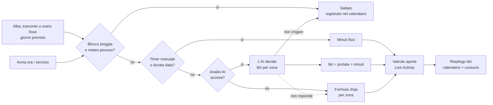

<p align="center">
  
</p>

<h1 align="center">
  <picture>
    <source media="(prefers-color-scheme: dark)" srcset="custom_components/irrigazione_ai/brand/dark_logo@2x.png">
    
  </picture>
</h1>

<p align="center">
  <b>L'impianto di irrigazione che decide da solo quanta acqua dare, zona per zona.</b><br>
  Un wizard, nessuna automazione da scrivere. Formula tua o agronomo AI, Live Activity sul telefono, registro dei litri.
</p>

<p align="center">
  <a href="https://github.com/acaonweb/irrigazione-ai/actions/workflows/validate.yml"></a>
  
  
  
  
  <a href="https://buymeacoffee.com/acaonweb"></a>
</p>

---

Di solito un impianto di irrigazione in Home Assistant è un groviglio di helper, sensori template e automazioni che solo chi le ha scritte capisce. **Irrigazione AI** lo sostituisce con un'unica integrazione. Le valvole, i sensori di umidità e il meteo li scegli da un wizard. Lei decide quando partire e quanto irrigare ogni zona, ti avvisa sul telefono e tiene il conto dell'acqua.

## ✨ Cosa sa fare

### 🧭 Un wizard al posto delle automazioni
Impianto, zone, programmazione, formula, AI e notifiche si configurano in pochi passi guidati, con descrizioni chiare per ogni campo. Le zone si aggiungono e si modificano quando vuoi dalla pagina dell'integrazione. Nessun file YAML, nessun riavvio.

### 🌱 Ogni zona è diversa
Una zona è una valvola (`switch` o `valve`) con i suoi dati:
- sensore di umidità del terriccio;
- portata in L/min;
- durata minima e massima;
- coefficiente;
- volume del terriccio;
- esposizione;
- **piante** che ci crescono, scritte con parole tue (per esempio "rosmarino e lavanda" o "pomodori").

Le zone partono in parallelo o una dopo l'altra, utile se la pressione dell'acqua è bassa.

### 📅 Ogni zona ha i suoi giorni
Per ogni zona scegli quando irrigare, anche direttamente dalla card:
- **spenta**;
- **un giorno sì e uno no**, a partire dal giorno in cui lo scegli;
- **giorni scelti**, quanti ne vuoi (per esempio lunedì, mercoledì, sabato e domenica);
- **tutti i giorni**.

All'orario programmato partono solo le zone in programma quel giorno. *Avvia ora* irriga tutte le zone tranne quelle spente. Cambiare i giorni non ricarica l'integrazione e non interrompe un ciclo in corso.

### 🧪 La formula la scrivi tu
La durata si calcola con un **template Jinja** nello stesso editor di Home Assistant. Hai a disposizione umidità, temperatura, meteo, portata, volume, esposizione e qualsiasi `states('sensor.xxx')`. Prima di salvare vedi **in anteprima quanti minuti darebbe a ogni zona** con i valori di adesso. Vuoi solo un timer fisso? `{{ 20 }}` e hai finito.

### 🤖 Un agronomo AI, senza server esterni
Accendi *Analisi AI* e prima di ogni ciclo un modello decide **se irrigare e quanti litri dare a ogni zona**. Tiene conto di:
- evapotraspirazione;
- pioggia caduta nelle ultime 12 ore (dallo storico di Home Assistant);
- previsioni orarie;
- esposizione e volume del terriccio;
- le **piante** di ogni zona: rosmarino, lavanda e succulente vogliono poca acqua, ortaggi e piante giovani di più.

Funziona con un'**entità AI Task** già configurata in Home Assistant oppure con la **tua API key** (OpenAI, Anthropic Claude, Google Gemini), o con **Ollama in locale**. Prima di salvare la chiave viene verificata con una richiesta di prova. Il pulsante *Analizza ora* ti fa vedere cosa farebbe l'AI senza aprire una valvola.

E il **prompt è tuo**: si modifica nelle opzioni come template Jinja, con tutti i dati a disposizione. Il formato della risposta lo aggiunge sempre l'integrazione, quindi nessuna modifica può rompere il calcolo dei litri.

### 🌵 Allarme terriccio secco
Se l'umidità del terriccio di una zona resta **sotto la soglia per 5 minuti** (25% di default, si cambia nelle opzioni; 0 = spento) arriva una notifica sui servizi di *Altre notifiche*, per esempio Pushover. Una sola per episodio: la zona torna "normale" quando risale di almeno 3 punti sopra la soglia. Ogni zona con sensore ha il sensore binario *Terriccio secco*, utile per la dashboard o per le tue automazioni, e la card colora di rosso la zona con la stessa soglia.

### 📱 Live Activity su iPhone e Android
Durante l'irrigazione il telefono mostra una **Live Activity** (schermata di blocco e Dynamic Island su iPhone) o un **Live Update** (Android 16+):

```
💧 Irrigazione in corso · AI                                   17:41
1️⃣ Secondo piano · fine 17:41
2️⃣ Sottotetto · fine 17:30
```

Gli aggiornamenti sono silenziosi, il suono arriva solo all'avvio e alla fine. Alla fine compare il riepilogo dei litri (`☑️ Secondo piano · 30 min · 21,8 L`) e dopo 5 minuti l'attività sparisce da sola. Funziona anche per le valvole aperte a mano, con l'ora della chiusura di sicurezza. Un tocco apre la dashboard che scegli.

### 📒 Registro e consumi d'acqua
Un **calendario** registra:
- ogni ciclo, con minuti e litri reali per zona e da dove è partito;
- le aperture manuali;
- i cicli saltati, con il motivo (pioggia, decisione dell'AI);
- la **prossima irrigazione prevista**.

I sensori *Acqua oggi / questo mese / totale*, per l'impianto e per ogni zona, si possono aggiungere alla **dashboard Energia**.

### 🛡️ Pensato per non allagare niente
- **Blocco pioggia** collegato al meteo.
- **Chiusura di sicurezza** per le valvole aperte a mano.
- **Chiusura automatica** delle valvole rimaste aperte se Home Assistant si riavvia a metà ciclo.
- **Tre tentativi** di chiusura per ogni valvola, con avviso se non si chiude.
- Se l'AI non risponde scegli tu se irrigare con la formula, spegnere l'AI o saltare il ciclo. In ogni caso ricevi una notifica.

### 🎛️ Tre card pronte all'uso
Si registrano da sole all'installazione e non richiedono mushroom, button-card o apexcharts.

- **`custom:irrigazione-ai-card`, i comandi:**
  - il riquadro *Irrigazione Generale*, con lo stato (attiva, inattiva con la prossima irrigazione, saltata per pioggia o dall'AI);
  - i pulsanti gialli *AI* e *Pioggia*;
  - una scheda per zona, con umidità (🔴 secco, 🟢 ottimale, 💧 umido), minuti previsti e AI, litri, ora di fine e batteria della valvola. Si illumina di blu con l'irrigatore che oscilla mentre irriga, e di rosso se il terriccio è secco;
  - la riga del timer (off/15/30/60);
  - la **programmazione di ogni zona**: Off, 1 sì 1 no, Giorni, 7/7 e i giorni della settimana da toccare, con la prossima irrigazione;
  - le durate previste o quelle dell'AI, la decisione dell'AI con il pulsante *Analizza* e il tempo rimanente.
- **`custom:irrigazione-ai-moisture-card`, umidità del terriccio di sensori a scelta:** lo stesso grafico con le fasce rosso, verde e blu, per piante che non sono zone dell'impianto (vasi annaffiati a mano, aromatiche…).
- **`custom:irrigazione-ai-charts-card`, grafici e registro:** litri di oggi, del mese e totali; consumo d'acqua degli ultimi 7 giorni a colonne; il **registro delle irrigazioni** con gli ultimi eventi (cicli, aperture manuali, cicli saltati con il motivo), ciascuno con orario, minuti, dettaglio delle zone e litri, più la prossima irrigazione prevista; meteo esterno delle ultime 24 ore; umidità del terriccio di ogni zona negli ultimi 5 giorni, con le fasce rosso, verde e blu.

## 🔄 Come nasce un ciclo



## 📦 Installazione

1. In Home Assistant apri **Impostazioni → Marketplace** (prima della 2026.11: **HACS**).
2. **Aggiungi da link** → `https://github.com/acaonweb/irrigazione-ai`, categoria *Integrazione*.
3. Installa **Irrigazione AI** e riavvia Home Assistant.
4. **Impostazioni → Dispositivi e servizi → Aggiungi integrazione → Irrigazione AI.**
5. Segui il wizard (sotto trovi la guida campo per campo), poi aggiungi le card a una dashboard.

## 📖 Guida pratica

Questa sezione spiega con calma tutto quello che il wizard ti chiede. Se è la prima volta, leggila una volta dall'inizio alla fine: ti evita le sorprese più comuni.

### 1. Cosa ti serve prima di iniziare

| Cosa | Obbligatorio? | Come trovarlo |
| --- | --- | --- |
| Una **valvola** per zona, vista da Home Assistant come entità `switch.…` o `valve.…` | Sì | *Impostazioni → Dispositivi e servizi → Entità*, cerca il nome della valvola. Accendendola e spegnendola deve aprirsi e chiudersi l'acqua |
| Un **sensore di umidità del terriccio** per zona (`sensor.…` in %) | No | Senza sensore la formula considera il 50%, l'AI riceve "sconosciuto" e l'allarme terriccio secco non c'è |
| Un'**entità meteo** (`weather.…`), per esempio quella di Met.no che Home Assistant installa da sola | No, ma consigliata | Serve al blocco pioggia, alla formula (`weather_factor`) e all'AI (previsioni) |
| Sensori di **temperatura e umidità esterna** | No | Se mancano si usano quelli dell'entità meteo |
| L'**app Home Assistant** sul telefono | Solo per Live Activity e notifiche sul telefono | App Store o Google Play, accedendo al tuo Home Assistant |

### 2. I dati di una zona, spiegati

**Portata (L/min).** Quanta acqua esce dalla zona in un minuto. Serve a trasformare minuti in litri e viceversa. Due modi per ricavarla:
- *dai gocciolatori*: numero di gocciolatori × litri/ora di ciascuno ÷ 60. Per esempio 22 gocciolatori da 2 L/h danno 22 × 2 ÷ 60 = **0,73 L/min**;
- *misurandola*: metti un gocciolatore (o l'uscita della linea) in un contenitore graduato per 5 minuti, dividi i litri per 5 e, se hai misurato un solo gocciolatore, moltiplica per il numero di gocciolatori.

**Durata minima e massima.** Qualunque calcolo (formula o AI) viene tenuto dentro questi limiti. La minima evita irrigazioni inutili da 1 minuto, la massima ti protegge da un valore sbagliato. Fa eccezione l'AI quando decide 0 litri per una zona: in quel caso la zona resta chiusa.

**Coefficiente.** Un moltiplicatore della formula predefinita: 1 = invariata, 1,2 = 20% di acqua in più, 0,8 = 20% in meno. Comodo per una zona che si asciuga prima delle altre.

**Volume del terriccio (L).** Quanta terra c'è da bagnare. L'AI lo usa per dosare i litri: più terra, più acqua per arrivare alla stessa umidità. Per stimarlo:
- fioriera rettangolare: lunghezza × larghezza × altezza della terra, in cm, ÷ 1000. Per esempio 100 × 20 × 18 cm = **36 L**;
- vaso tondo: 3,14 × raggio × raggio × altezza, in cm, ÷ 1000;
- più vasi sulla stessa linea: somma i volumi.

**Esposizione.** Da che parte prende il sole la zona (nord, sud, est, ovest). Sud e ovest asciugano di più, nord di meno. La usa l'AI; nella formula è disponibile come variabile `exposure`.

**Piante.** Scrivi con parole tue cosa cresce nella zona, il più precise possibile: "rosmarino, lavanda e timo in fioriera", "pomodori e basilico", "limone in vaso da 50 cm", "gerani appena trapiantati". L'AI conosce il fabbisogno d'acqua delle piante comuni e dosa di conseguenza: le mediterranee ne vogliono poca, ortaggi, fiori e piante giovani di più. Puoi usarle anche nella formula con la variabile `plants`.

**Formula della zona.** Facoltativa: se la scrivi, vale solo per questa zona e sostituisce quella dell'impianto (vedi il punto 6).

### 3. Quando irrigare: orario e giorni

**L'orario** vale per tutto l'impianto e si sceglie in *Programmazione*:
- **tramonto** o **alba**, più uno scostamento in minuti. Positivo = dopo, negativo = prima: `-30` con l'alba vuol dire mezz'ora prima che sorga il sole;
- **orario fisso**, per esempio 21:00. Lo scostamento in questo caso non conta.

Irrigare la sera o all'alba riduce l'evaporazione: è la scelta migliore d'estate.

**I giorni** si scelgono per ogni zona, nel form della zona o dalla card (sezione 📅 Programmazione):

| Scelta | Cosa succede | Esempio |
| --- | --- | --- |
| Spenta | La zona non irriga mai, neanche con *Avvia ora* | D'inverno, o una zona temporaneamente vuota |
| Un giorno sì e uno no | Irriga il giorno in cui lo scegli, poi a giorni alterni, senza guardare la settimana | Scelto martedì: mar, gio, sab, lun, mer… |
| Giorni scelti | Irriga nei giorni della settimana che indichi | Lun, mer, sab e dom |
| Tutti i giorni | Ogni giorno | Piena estate, vasi piccoli |

Nel form, il campo *Giorni* conta **solo** con "Giorni scelti" e viene ignorato con le altre scelte. Dalla card basta toccare i giorni: la riga si accende in blu e la modifica vale subito.

All'orario partono solo le zone in programma quel giorno. *Avvia ora* (o l'interruttore *Irrigazione*) avvia invece tutte le zone che non sono spente.

### 4. Notifiche: come riceverle

L'integrazione invia notifiche per: avvio (con i minuti di ogni zona), fine, interruzione, ciclo saltato per pioggia o dall'AI, errore dell'AI, valvola chiusa dalla sicurezza, valvola che non si chiude, terriccio secco.

Le manda alle **azioni di notifica** che scrivi nel campo *Altre notifiche* (passo *Programmazione*). Un'azione di notifica è un servizio di Home Assistant che si chiama `notify.qualcosa`. Le più comuni:

| Dove vuoi la notifica | Cosa scrivere | Cosa ti serve |
| --- | --- | --- |
| Sul telefono, con l'app Home Assistant | `notify.mobile_app_<nome_telefono>` | L'app installata e collegata |
| Pushover | `notify.pushover` | L'integrazione Pushover |
| Telegram | `notify.<nome_del_bot>` | L'integrazione Telegram |
| Nelle notifiche di Home Assistant (la campanella) | `notify.persistent_notification` | Niente, c'è sempre |

**Come trovare il nome esatto:** apri *Strumenti → Azioni* (prima della 2026.8 il menu si chiamava *Strumenti per sviluppatori*), scrivi `notify.` nella casella di ricerca e copia il nome che ti interessa. Puoi metterne più di uno: ogni messaggio arriva a tutti.

Le notifiche e la Live Activity sono due cose diverse e si possono usare insieme: le notifiche sono messaggi singoli, la Live Activity è un riquadro che resta sullo schermo e si aggiorna durante l'irrigazione.

### 5. Live Activity: requisiti e impostazione

- **iPhone e iPad:** iOS/iPadOS 17.2 o successivo e l'app Home Assistant aggiornata. Compare nella schermata di blocco e nella Dynamic Island.
- **Android:** Android 16 o successivo per il *Live Update*; sulle versioni precedenti arriva come notifica normale che si aggiorna al suo posto.

Nel passo *Programmazione*, in **Dispositivi per la Live Activity**, l'elenco propone da solo i telefoni e tablet con l'app. Selezionali tutti quelli su cui la vuoi.

**Pagina da aprire** è la dashboard che si apre toccando la Live Activity. Si scrive come percorso, senza l'indirizzo del server: apri la dashboard dal browser e copia la parte dell'indirizzo dopo il nome del server. Per esempio da `http://homeassistant.local:8123/lovelace/irrigazione` scrivi `/lovelace/irrigazione`.

### 6. Scrivere una formula tua

La formula è un **template Jinja**, lo stesso linguaggio dei modelli di Home Assistant. Deve restituire **un numero: i minuti di irrigazione** della zona. Il risultato viene comunque tenuto tra durata minima e massima.

**Passo 1, prova sul sicuro.** Apri *Strumenti → Modello* (prima della 2026.8: *Strumenti per sviluppatori → Modello*) e incolla, per esempio:

```jinja

{{ 40 - moisture / 2 }}
```

A destra vedi il risultato con i valori di adesso. Le variabili dell'integrazione (`moisture`, `temperature`…) lì non esistono, per questo le definisci tu con `` per provare.

**Passo 2, mettila nell'integrazione.** *Configura → Formula*: incolla la formula **senza** le righe `` delle variabili che l'integrazione ti fornisce già (vedi la tabella in *La formula nel dettaglio*). Prima di salvare compare l'**anteprima** con i minuti che darebbe a ogni zona: se un numero non ti convince, torna indietro e correggi.

**Passo 3, se serve, una formula per zona.** Nel form della zona, il campo *Formula della zona* sostituisce quella dell'impianto solo per quella zona.

Esempi, dal più semplice:

```jinja
{# Sempre 20 minuti #}
{{ 20 }}

{# Più secco = più minuti: 15 min al 70% di umidità, 35 min al 30% #}
{{ 50 - moisture / 2 }}

{# Come sopra, ma più acqua col caldo (oltre 25 °C) e niente se piove #}
{{ (50 - moisture / 2) * (1.3 if temperature > 25 else 1) * weather_factor }}

{# Litri necessari a riportare il terriccio al 60%, trasformati in minuti #}
{{ soil_volume * (60 - moisture) / 100 / flow_rate }}

{# Metà acqua se nella zona ci sono piante mediterranee #}
{{ (50 - moisture / 2) * (0.5 if 'rosmarino' in plants | lower or 'lavanda' in plants | lower else 1) }}

{# Minuti decisi da un tuo helper (input_number) #}
{{ states('input_number.minuti_irrigazione') | float(20) }}
```

Se una formula personale smette di funzionare (per esempio un sensore diventa *non disponibile*), l'integrazione usa quella predefinita e scrive l'errore nell'attributo `formula_error` del sensore *Durata prevista* della zona. Così non resti mai senza irrigazione.

### 7. Configurare l'AI

1. **Scegli il servizio** nel passo *Analisi AI*:
   - **AI Task**: usa un'integrazione AI già configurata in Home Assistant (OpenAI, Google Gemini, Anthropic, Ollama…). È la scelta più semplice se ne hai già una;
   - **OpenAI, Anthropic, Gemini**: serve una **API key** del servizio. Il wizard mostra il link alla pagina dove crearla. Attenzione a copiare la **chiave segreta** (per OpenAI inizia con `sk-`, per Anthropic con `sk-ant-`, per Gemini con `AIza`) e non l'identificativo della chiave. Su OpenAI e Anthropic l'account deve avere un po' di credito prepagato (bastano pochi euro, vedi la FAQ sui costi);
   - **Ollama**: un modello che gira gratis su un computer della tua rete. Indica l'indirizzo (per esempio `http://192.168.1.20:11434`) e il modello scaricato (per esempio `llama3.1`).
2. Prima di salvare viene inviata **una richiesta di prova**: se qualcosa non va, l'errore del servizio compare nel form.
3. Scegli **cosa fare se l'AI non risponde**: irrigare con la formula (consigliato), irrigare con la formula e spegnere l'AI, oppure saltare il ciclo.
4. **Note per l'AI** (facoltative): tutto quello che non sta nei campi, per esempio "terrazzo molto ventoso", "vasi in terracotta che asciugano in fretta".
5. Accendi l'interruttore **Analisi AI** (o il pulsante giallo *AI* della card) e premi **Analizza ora**: vedi cosa deciderebbe adesso, zona per zona, senza aprire le valvole.

L'AI viene interpellata **all'inizio di ogni ciclo**, programmato o avviato a mano, dopo il controllo della pioggia. Non viene interpellata se il timer manuale è attivo o se avvii con una durata fissa.

### 8. Allarme terriccio secco

Nel passo *Programmazione* imposta la **soglia** (25% di default; 0 = spento). Se una zona con sensore resta sotto la soglia per 5 minuti ricevi **una notifica** sulle *Altre notifiche* (punto 4) e si accende il sensore binario *Terriccio secco* della zona. Non ricevi altre notifiche finché l'umidità non risale almeno 3 punti sopra la soglia: un valore che oscilla intorno al 25% non ti tempesta di messaggi.

### 9. Usare l'integrazione nelle tue automazioni

Tutto quello che vedi nella card è un'entità o un'azione, quindi puoi usarlo nelle automazioni. Alcuni esempi:

```yaml
# Spegne una zona da novembre a marzo e la riaccende in primavera
triggers:
  - trigger: time
    at: "08:00:00"
actions:
  - action: irrigazione_ai.set_schedule
    target:
      entity_id: select.balcone_programmazione
    data:
      mode: "{{ 'off' if now().month in [11, 12, 1, 2, 3] else 'days' }}"
```

```yaml
# Avvia un ciclo extra di 10 minuti se fa molto caldo
triggers:
  - trigger: numeric_state
    entity_id: sensor.temperatura_esterna
    above: 35
actions:
  - action: irrigazione_ai.start
    data:
      duration: 10
```

```yaml
# Notifica speciale quando l'AI decide di non irrigare
triggers:
  - trigger: state
    entity_id: sensor.irrigazione_decisione_ai
    to: skip
actions:
  - action: notify.mobile_app_mio_telefono
    data:
      message: "Oggi niente acqua: {{ state_attr('sensor.irrigazione_decisione_ai', 'reason') }}"
```

I nomi delle entità dipendono dal nome che hai dato all'impianto e alle zone: li trovi in *Impostazioni → Dispositivi e servizi → Irrigazione AI*.

### 10. Se avevi già automazioni di irrigazione

Puoi provare l'integrazione senza toccare quello che hai: non modifica automazioni, helper, `configuration.yaml` o dashboard, usa solo le valvole e le notifiche che le assegni.

Finché convivono:
- metti **Chiusura di sicurezza = 0** e spegni **Chiudi le valvole all'avvio**, altrimenti l'integrazione chiuderebbe anche le valvole aperte dalle tue automazioni;
- scegli giorni o orari diversi da quelli delle tue automazioni, per non irrigare due volte;
- tieni presente che litri e calendario dell'integrazione conteranno anche le irrigazioni delle tue automazioni, come aperture manuali.

Quando sei pronto: **spegni** (non cancellare) le tue automazioni, riattiva le due sicurezze e sistema i giorni. Se cambi idea, riaccendi le automazioni e rimuovi l'integrazione: si porta via le sue entità e i suoi dati e non lascia altro, a parte lo storico nel database e le eventuali card nelle dashboard.

### 11. Problemi comuni

| Problema | Soluzione |
| --- | --- |
| Non vedo le card nuove, o vedo quelle vecchie | Ricarica la pagina svuotando la cache (Ctrl+Shift+R nel browser; nell'app chiudila del tutto e riaprila) |
| "La API key è stata rifiutata" | Hai copiato la chiave segreta e non il suo ID? È ancora attiva? Il progetto può usare il modello scelto? Il messaggio d'errore del servizio è riportato tra parentesi |
| Le *Durate AI* sono vuote | L'AI non ha ancora analizzato nulla: premi *Analizza ora* |
| Il blocco pioggia non scatta mai | Serve un'entità meteo, e il suo stato deve indicare pioggia (`rainy`, `pouring`…) al momento dell'avvio |
| I litri restano a 0 | Controlla la portata della zona: con 0 L/min i litri sono sempre 0 |
| "Impossibile configurare" dopo un aggiornamento | *Impostazioni → Sistema → Registri*, cerca `irrigazione_ai` e apri una [issue](https://github.com/acaonweb/irrigazione-ai/issues) con il messaggio |
| Una valvola non si chiude | L'integrazione riprova tre volte e ti avvisa: controlla la batteria e la copertura radio della valvola |
| Ho cambiato le opzioni durante un ciclo e non succede niente | È voluto: le modifiche si applicano alla fine del ciclo, per non interrompere l'irrigazione |


## 🧭 Il wizard, passo per passo

| Passo | Cosa chiede |
| --- | --- |
| 1. Impianto | Nome; entità meteo e sensori di temperatura e umidità esterna, tutti facoltativi (senza meteo il blocco pioggia resta inattivo) |
| 2. Zone | Una o più zone: valvola, sensore del terriccio, portata, durata minima e massima, coefficiente, volume, esposizione, piante, quando irrigarla (spenta, un giorno sì e uno no, giorni scelti, tutti i giorni), formula propria facoltativa |
| 3. Programmazione | Partenza riferita al tramonto, all'alba (con scostamento in minuti, anche negativo) o a un orario fisso, zone in parallelo o in sequenza, chiusura di sicurezza, chiusura al riavvio, dispositivi per la Live Activity, pagina da aprire, altre notifiche (per esempio Pushover), soglia dell'allarme terriccio secco |
| 4. Formula | Editor Jinja con anteprima dei minuti per zona |
| 5. Analisi AI | Nessuna, AI Task, OpenAI, Anthropic, Gemini od Ollama; comportamento se l'AI non risponde; note per l'AI (piante, vasi, clima); editor del prompt |

Tutto si può cambiare dopo da **Configura** (opzioni) e da **Aggiungi zona / Riconfigura** sulle singole zone.

## 🎛️ Card

Le trovi in *Aggiungi scheda* cercando **"Irrigazione AI"**, oppure in YAML:

```yaml
type: custom:irrigazione-ai-card          # comandi
title: Irrigazione Generale               # facoltativo
entity: sensor.irrigazione_stato          # facoltativo, se hai più impianti
```

```yaml
type: custom:irrigazione-ai-charts-card   # grafici e registro
log_items: 8                              # facoltativo: eventi mostrati nel registro
show_log: true                            # facoltativo: false per nascondere il registro
```

```yaml
type: custom:irrigazione-ai-moisture-card  # umidità del terriccio di sensori a scelta
entities:
  - entity: sensor.prezzemolo_umidita
    name: Prezzemolo
  - entity: sensor.rosmarino_umidita
    name: Rosmarino
hours: 120                                 # facoltativo: ore mostrate (default 5 giorni)
threshold: 25                              # facoltativo: soglia "secco" (default quella dell'impianto)
```

Le colonne dei 7 giorni usano le statistiche di Home Assistant, calcolate alla fine di ogni ora: su un'installazione nuova compaiono dopo il primo ciclo e la prima ora completa.

**Vista pronta**, due colonne come nella foto in cima (modifica dashboard → ⋮ → *Editor di configurazione*, oppure una nuova vista in YAML):

```yaml
title: Irrigazione
path: irrigazione
icon: mdi:sprinkler
type: sections
max_columns: 2
sections:
  - type: grid
    cards:
      - type: custom:irrigazione-ai-card
        grid_options: { columns: full }
  - type: grid
    cards:
      - type: custom:irrigazione-ai-charts-card
        grid_options: { columns: full }
      - type: calendar
        entities: [calendar.irrigazione_registro_irrigazioni]
        grid_options: { columns: full }
```

Toccando una zona apri o chiudi la sua valvola (vale la chiusura di sicurezza). Toccando una durata si aprono i dettagli del sensore. La batteria della valvola viene trovata da sola, se il dispositivo della valvola ha un sensore batteria. I grafici si aggiornano ogni 10 minuti.

## 🧩 Entità

| Entità | A cosa serve |
| --- | --- |
| Interruttore *Irrigazione* | Acceso = ciclo in corso. Accenderlo avvia, spegnerlo ferma e chiude le valvole |
| Interruttore *Blocco pioggia* | Se il meteo indica pioggia il ciclo non parte |
| Interruttore *Analisi AI* | A ogni ciclo l'AI decide se e quanto irrigare |
| Selettore *Timer manuale* | 15/30/60 minuti per tutte le zone al posto della formula |
| Pulsanti *Avvia ora*, *Ferma*, *Analizza ora* | Comandi immediati |
| Sensori *Stato*, *Tempo rimanente*, *Prossima irrigazione*, *Ultima irrigazione*, *Ultimo blocco* | Stato dell'impianto |
| Sensore *Decisione AI* | Irrigare / Saltare / Errore, con motivo e litri per zona |
| Sensori *Acqua oggi*, *Acqua questo mese*, *Acqua totale* | Litri di tutte le zone |
| Calendario *Registro irrigazioni* | Cicli, aperture manuali, cicli saltati, prossima irrigazione |
| Per zona: sensore binario *Terriccio secco* | Acceso dopo 5 minuti sotto la soglia; attributi `moisture` e `threshold` |
| Per zona: selettore *Programmazione* | Spenta, un giorno sì e uno no, giorni scelti, tutti i giorni; negli attributi i giorni (`days`) e la prossima irrigazione della zona (`next_run`) |
| Per zona: *Durata prevista*, *Durata AI*, *Fine prevista*, *Acqua oggi*, *Acqua totale* | Minuti, litri e orari della zona; nella durata prevista ci sono anche formula usata ed eventuale errore |

## 🛠️ Servizi

| Servizio | Cosa fa |
| --- | --- |
| `irrigazione_ai.start` | Avvia un ciclo. Facoltativi: `config_entry_id`, `duration` (minuti per tutte le zone), `force` (ignora il blocco pioggia) |
| `irrigazione_ai.stop` | Ferma il ciclo e chiude le valvole |
| `irrigazione_ai.set_schedule` | Cambia la programmazione di una zona (destinazione: il suo selettore *Programmazione*). `mode`: `off`, `alternate`, `days`, `daily`; `days`: per esempio `[mon, wed, sat, sun]`. Solo i giorni impostano anche "giorni scelti"; una lista vuota spegne la zona |
| `irrigazione_ai.analyze` | Chiede all'AI una valutazione senza irrigare e restituisce decisione, motivo, litri e minuti per zona |

## 🧪 La formula nel dettaglio

Formula predefinita:

```jinja
{{ (20 + 20 * (100 - moisture) / moisture + 20 * temperature / 25) * 0.9 * weather_factor * coefficient }}
```

| Variabile | Significato |
| --- | --- |
| `moisture` | Umidità del terriccio della zona in % (minimo 10; 50 senza sensore) |
| `moisture_raw` | Umidità del terriccio così com'è (`none` se manca) |
| `temperature` | Temperatura esterna in °C (20 se manca) |
| `humidity` | Umidità esterna in % (`none` se manca) |
| `weather` | Stato dell'entità meteo (`sunny`, `cloudy`, `rainy`…) |
| `weather_factor` | Sereno 1,1 · poco nuvoloso 0,8 · nuvoloso 0,5 · nebbia 0,6 · pioggia 0,2 · altro 1 |
| `coefficient`, `flow_rate`, `soil_volume`, `exposure` | Dati della zona (portata in L/min, volume in L, `north`/`south`/`east`/`west`) |
| `min_duration`, `max_duration` | Limiti della zona in minuti |
| `plants` | Piante della zona, come le hai scritte (testo vuoto se non indicate) |

Il risultato resta sempre tra durata minima e massima. Se una formula personalizzata smette di funzionare, per esempio perché un sensore diventa non disponibile, si usa quella predefinita e l'errore compare nell'attributo `formula_error`.

```jinja
{# Litri in base al volume del terriccio, convertiti in minuti #}
{{ soil_volume * (60 - moisture) / 100 / flow_rate }}

{# Più acqua con l'esposizione a sud #}
{{ (40 - moisture / 2) * (1.3 if exposure == 'south' else 1) * weather_factor }}

{# Meno acqua alle piante mediterranee #}
{{ (40 - moisture / 2) * (0.6 if 'rosmarino' in plants | lower else 1) * weather_factor }}

{# Tempo fisso deciso da un helper #}
{{ states('input_number.minuti_irrigazione') | float(20) }}
```

## 🤖 L'AI nel dettaglio

**Cosa riceve:**
- data e ora;
- posizione approssimata (un solo decimale);
- meteo attuale;
- ore e percentuale di pioggia nelle ultime 12 ore;
- previsioni orarie delle prossime 12 ore;
- per ogni zona: piante, umidità del terriccio, volume, esposizione, portata, limiti e minuti della formula;
- le tue note.

**Le regole che segue:**
- stima l'evapotraspirazione del substrato;
- sottrae la pioggia caduta e quella prevista;
- dimensiona i litri sul **volume del terriccio** di ogni zona: più substrato, più acqua per arrivare alla stessa umidità;
- non irriga se ha piovuto per più di metà delle ore recenti o se è attesa pioggia significativa;
- dà 0 litri sopra il 70% di umidità del terriccio;
- dà un minimo di mantenimento tra 50% e 65%, anche con volumi grandi (oltre 1000 L);
- se ha piovuto meno di metà delle ore, riduce i litri in proporzione;
- dosa l'acqua sulle **piante**: poca per quelle resistenti alla siccità (succulente, cactus, rosmarino, lavanda, olivo, aromatiche mediterranee), di più per ortaggi, piante da fiore o a foglia larga, agrumi in vaso e piante giovani, tenendo conto della stagione;
- con l'esposizione a sud aumenta l'acqua, a nord la riduce.

**Il prompt è modificabile.** Nelle opzioni AI c'è l'editor (template Jinja), già compilato con il prompt predefinito. Variabili:

| Variabile | Contenuto |
| --- | --- |
| `data_json` | Tutti i dati qui sopra in JSON (se il tuo prompt non usa i dati, vengono aggiunti in fondo da soli) |
| `data` | Gli stessi dati come oggetto, per esempio `data.weather_now.temperature_c` |
| `zones`, `weather_now`, `rain_last_hours`, `forecast_next_hours` | Le singole parti dei dati |
| `notes` | Le tue note per l'AI |
| `language` | La lingua in cui l'AI deve rispondere |

In fondo l'integrazione aggiunge sempre le istruzioni sul formato della risposta (chiavi JSON e lingua dei motivi), perché è da lì che ricava i litri. Un prompt che non funziona viene rifiutato prima di salvare. Svuotando il campo torni al prompt predefinito, che riceve i miglioramenti delle nuove versioni.

```jinja
Sei un agronomo esperto di piante in vaso su un terrazzo ventoso.
- {{ z.name }}: {{ z.soil_moisture_percent }}% di umidità, {{ z.soil_volume_liters }} L

Oggi ci sono {{ weather_now.temperature_c }} °C. Dati completi: {{ data_json }}
```

**Cosa restituisce:** se irrigare, un motivo breve (nella lingua di Home Assistant) e, per ogni zona, i litri e un breve riassunto tecnico ("ha piovuto a sufficienza" quando i litri sono 0 per la pioggia). I litri diventano minuti con la portata della zona, arrotondati per eccesso e limitati tra minimo e massimo. Una zona con 0 litri resta chiusa.

**Se qualcosa va storto:**
- *irriga con la formula* (predefinito);
- *irriga con la formula e spegni l'analisi AI*;
- *salta il ciclo*.

In ogni caso arriva una notifica. Con il timer manuale, o con una durata passata a `irrigazione_ai.start`, l'AI non viene interpellata.

## 📒 Storico e consumi

I litri si calcolano come tempo di apertura per portata, per ogni apertura (cicli e manuali), e si aggiornano ogni 30 secondi mentre una valvola è aperta. "Oggi" si azzera a mezzanotte, "questo mese" il primo del mese. Storico e contatori restano dopo i riavvii (sono salvati in `.storage`) e vengono cancellati se rimuovi l'integrazione. Il registro conserva gli ultimi 1000 eventi.

## ❓ Domande frequenti

**Posso usarla senza sensori?** Sì. Meteo e sensori sono tutti facoltativi. Con la formula `{{ 20 }}` hai un timer fisso con programmazione, sicurezza e registro.

**Aggiorno dalla 0.9: cosa succede ai giorni?** Ogni zona eredita la frequenza che avevi (per esempio "una volta a settimana, lunedì" diventa "giorni scelti: lunedì"), quindi l'impianto continua a irrigare negli stessi giorni. Il vecchio selettore *Frequenza* sparisce.

**In che lingua sono i testi?** Form, entità e card seguono la lingua del tuo profilo. Notifiche, Live Activity, eventi del calendario e motivazioni dell'AI seguono la lingua di sistema (Impostazioni → Sistema → Generale): oggi italiano e inglese, le altre lingue usano l'inglese.

**Quanto costa l'AI?** Una richiesta per ciclo, più quelle che lanci con *Analizza ora*. Con modelli piccoli (per esempio `gpt-4.1-mini` o `gemini-2.5-flash`) ogni richiesta costa una frazione di centesimo: con 2–3 cicli a settimana, 5 € di credito durano ben più di un anno. Con Ollama in locale, o con AI Task su un modello locale, è gratis.

**La Live Activity funziona su Android?** Sì, come Live Update da Android 16. Sulle versioni precedenti arriva come notifica normale, che si aggiorna al suo posto.

**Posso avere più impianti?** Sì: aggiungi l'integrazione più volte, una per impianto (per esempio terrazzo e giardino).

## ☕ Ti piace?

Se Irrigazione AI ti fa risparmiare acqua (e automazioni), puoi offrirmi un caffè:

<a href="https://buymeacoffee.com/acaonweb"></a>

Segnalazioni e idee sono benvenute nelle [issue](https://github.com/acaonweb/irrigazione-ai/issues).

---

## English

**Irrigazione AI** turns a messy pile of helpers and automations into one Home Assistant integration, set up through a wizard:
- per-zone durations from a **Jinja formula you write**, with a live preview;
- an optional **AI agronomist** (Home Assistant AI Task, OpenAI, Anthropic, Gemini or local Ollama) that decides liters per zone from rain history, forecast and soil data, with an **editable Jinja prompt**;
- **Live Activities on iPhone and Live Updates on Android 16+**;
- a **calendar log** with real liters per zone;
- **water sensors** for the Energy dashboard;
- **safety closing** of valves;
- two ready-made **Lovelace cards** (controls and charts), no extra frontend dependencies.

Install from the Marketplace (or HACS) with **Add from link**, then add the *Irrigazione AI* integration. UI, notifications and Live Activities in Italian and English. The step-by-step guide above (📖 *Guida pratica*) covers flow rate and soil volume, schedules, notifications, Live Activities, writing your own formula, AI setup, the dry-soil alarm, automations and troubleshooting. Like it? [Buy me a coffee](https://buymeacoffee.com/acaonweb) ☕

## Licenza

MIT
